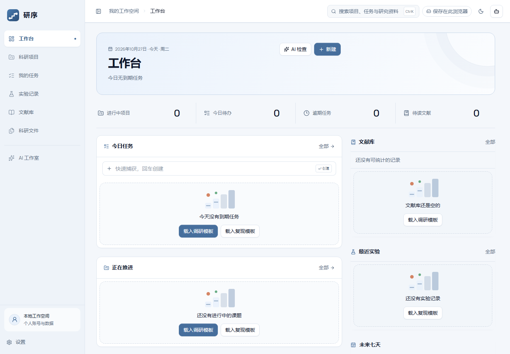
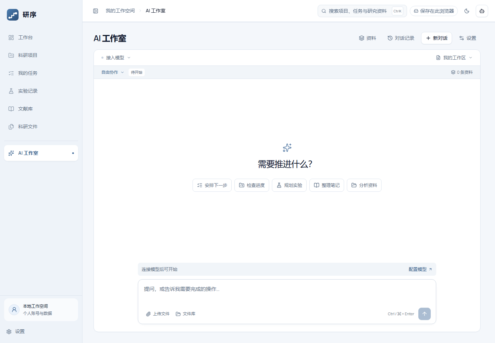

# 研序 · Research Workspace

[](https://github.com/taoze190-afk/research-workspace/actions/workflows/ci.yml)
[](LICENSE)
[](https://nodejs.org/)

面向个人研究者的科研工作台，将项目、任务、实验、文献、文件与 AI 工作流连接起来。提供浏览器本地模式、自建服务端和 Windows 桌面版。

AI 可以读取选定的研究资料、分析明确附带的文件，并提出可预览、可采纳的记录变更。正式记录保留在各业务模块中，采纳结果后可继续跟进。



## 功能

| 模块         | 主要能力                                                              |
| ------------ | --------------------------------------------------------------------- |
| 工作台与项目 | 近期待办、项目进度、里程碑、关联实验与文献                            |
| 任务         | 子任务、优先级、截止日期、重复任务和批量处理                          |
| 实验         | 目的与假设、方法、数据来源、结果、观察与后续任务                      |
| 文献         | 阅读状态、结构化笔记、项目关联与阅读任务                              |
| 科研文件     | 原件上传下载、项目归档、PDF / DOCX / 文本 / 图片预览、多选与 ZIP 打包 |
| AI 工作室    | 连续对话、上传文件、粘贴图片、资料来源清单、操作预览与保存回执        |
| 账号与权限   | 管理员和普通用户、独立数据、头像、会话管理与平台 AI 授权              |

界面支持浅色与深色主题、响应式布局、键盘操作和全局搜索。

## AI 与模块联动

**选择工作目标 → 核对资料 → 生成建议 → 预览采纳 → 查看记录 → 继续跟进**

- 项目安排下一步，任务拆分执行步骤，实验进行复盘，文献整理阅读笔记，文件提供分析依据。
- 8 个工作流、14 类受控记录操作；生成建议不会直接写入。
- 写入经过字段白名单、当前账号、目标范围和事务校验；失败可重试，成功回执保留。
- 全局副驾驶转入工作室时接续讨论、草稿和操作状态。
- 支持 DeepSeek、Gemini、智谱、Kimi 与兼容接口；模型服务和密钥由使用者自行配置。



当前没有云端会话同步、文件全文向量检索或后台长任务。对话与回执按账号保存在当前浏览器；文件正文在明确附带后读取。详细设计见 [AI 联动方案](docs/ai-research-workbench-plan.md)。

## 快速开始

需要 **Node.js 24+** 和 npm。

```bash
git clone https://github.com/taoze190-afk/research-workspace.git
cd research-workspace
npm ci
npm run dev
```

打开 `http://localhost:5173`。没有服务端时使用浏览器本地模式，可以选择空白工作区或载入演示数据。

### 启用账号与服务端

另开一个终端：

```bash
npm run server:dev
```

此命令使用 `deploy/dev.env.example`，监听 `127.0.0.1:8787`，适用于 Windows、macOS 和 Linux 的本机开发。前端会代理 `/api`。首次注册的账号为平台所有者，可在管理控制台创建其他用户。开发样例允许注册，生产环境请使用 [部署说明](docs/deploy-1panel.md) 和 [生产环境变量样例](deploy/env.example)。

### Windows 桌面版

可从 [Releases](https://github.com/taoze190-afk/research-workspace/releases) 查看发布的安装包，或在 Windows x64 上构建：

```powershell
npm ci
npm run desktop:dist
```

构建需要 Chrome / Chromium，可用 `CHROME_PATH` 指定可执行文件。输出位于 `release/`，包含安装版、免安装版和 SHA256 校验文件。程序内置 Node.js 与 SQLite；使用者无需另装 Node。也可在 Actions 中手动运行 **Build Windows desktop** 获取构建产物。

桌面版数据位于 `%APPDATA%\YanxuResearch`。免安装 EXE 不会把数据保存在其旁边。完整备份和模型配置见 [桌面版使用说明](docs/desktop-windows.md)。当前 Windows 包未配置代码签名。

## 存储与备份

| 运行形态     | 正式研究记录与文件                | 对话与设置                 |
| ------------ | --------------------------------- | -------------------------- |
| 浏览器本地   | 当前浏览器 IndexedDB              | 当前浏览器本地存储         |
| 自建服务端   | 服务端 SQLite；浏览器保存同步镜像 | 按账号保存在当前浏览器     |
| Windows 桌面 | 本机用户目录的 SQLite             | 同一用户目录中的浏览器数据 |

研究记录 JSON 导出不包含原文件或 AI 对话。浏览器本地存储不等于备份。服务端 SQLite 备份包含服务器原文件；桌面版完整迁移需先退出程序，再复制整个数据目录。当前采用各账号数据独立的方式，不提供课题组共享空间。

## 开发与验证

```bash
npm test                 # 单元与集成测试，使用合成资料和模拟模型
npm run build            # TypeScript 检查与前端构建
npm run check:public     # 待跟踪文件、敏感路径和凭据格式检查
npm run verify:platform  # 构建后运行的隔离浏览器验证，需要 Chrome
npm run desktop:verify   # 先构建桌面包，再验证实际 EXE
```

CI 在 Ubuntu 和 Windows 上运行测试与构建。浏览器验证支持 `CHROME_PATH`；截图、报告、测试数据库及浏览器档案均不提交到仓库。自动化验证中的模拟模型不代表真实模型的回答质量。

## 项目结构

```text
src/          React 页面、业务组件、数据与领域逻辑
server/src/   Node.js HTTP 接口、账号权限、SQLite 与文件存储
desktop/      Electron 启动与本机服务
deploy/       环境样例、Nginx 和 systemd 配置
tests/        单元与集成测试
scripts/      构建、备份、浏览器验证和公开文件检查
docs/         部署、存储、设计和使用说明
```

技术栈：React、TypeScript、Vite、Tailwind CSS、Radix UI、Dexie、Node.js SQLite、Electron、Vitest、Puppeteer。

## 文档与贡献

- [文档导航](docs/README.md)
- [架构与存储](docs/architecture.md)
- [服务端部署](docs/deploy-1panel.md)
- [Windows 桌面版](docs/desktop-windows.md)
- [参与贡献](CONTRIBUTING.md) · [安全报告](SECURITY.md)

欢迎通过 Issue 和 Pull Request 反馈问题与提交改进。请使用合成数据复现，不要上传个人科研资料、数据库或模型密钥。

## 许可证

原创代码采用 [MIT License](LICENSE)。第三方照片、字体与依赖保留各自许可证，见 [第三方说明](THIRD_PARTY_NOTICES.md)。
