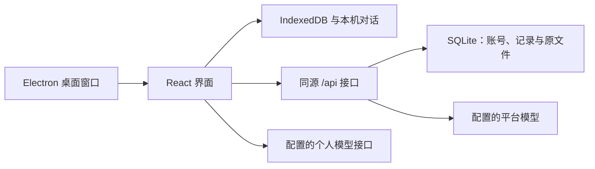

# 架构、权限与存储

## 运行方式

浏览器本地模式仅使用 IndexedDB 和本地存储。自建服务端使用 Node.js 原生 HTTP 与 SQLite，前端通过同源 `/api` 访问，由 Vite 或生产反向代理转发。桌面版将静态界面、Node 和同源本机接口内置，只监听回环地址。

## 账号与权限

服务端支持平台所有者、管理员与普通用户。管理员管理账号、注册设置和平台模型权限；所有角色的研究数据仍按账号独立保存。当前没有团队空间或项目成员共享机制。

业务接口先验证会话，用户身份来自服务端会话，不能由请求体指定。SQLite 查询与变更带用户归属条件。密码使用 scrypt 散列；会话只存令牌哈希。Cookie 使用 HttpOnly、SameSite=Strict；生产 HTTPS 环境应启用 Secure。写请求需要 `x-rw-client: rw`，并配置登录限速与会话撤销。

公开的健康检查、注册选项与认证入口不要求已有登录会话。注册默认关闭，首次创建本机或服务器管理员时开放；之后按管理设置执行。

## 数据位置

| 内容                         | 浏览器本地                      | 自建服务端                       |
| ---------------------------- | ------------------------------- | -------------------------------- |
| 项目、任务、实验、文献与关系 | `research-workspace` IndexedDB  | `DATA_DIR/research-workspace.db` |
| 科研原文件                   | `research-file-vault` IndexedDB | SQLite 的 `researchFiles` 表     |
| AI 对话和操作回执            | 按账号保存的 localStorage       | 仍在当前浏览器 localStorage      |
| 文件附件                     | 对话保存原件引用                | 按当前账号从服务器读取原件       |
| 界面偏好、待同步队列         | 本机存储                        | 本机存储                         |

服务器模式的浏览器 IndexedDB 是镜像。编辑先保存在本机，再排队上传；服务器不可达时保留队列，恢复后重试。退出或切换账号时清理镜像，避免混用其他账号的数据。正式同步与 AI 操作分别处理重复请求和已执行回执，不能把本机回执视作跨设备的执行幂等键。

## AI 读写

界面根据当前工作流构建有长度预算的研究摘要。文件元数据不等于正文，原件须明确附带后才读取。每轮保存来源清单和时间，不复制完整研究正文作为审计快照。

模型返回操作提议，由用户在预览卡中采纳。动作引擎检查白名单字段、真实目标、当前账号与所选范围，并在事务内重新读取记录。批次失败回滚；成功结果保留回执。笔记、实验正文默认追加。

平台模型通过服务端转发，密钥来自服务端环境变量。个人接口由浏览器直接请求服务商，会受服务商 CORS 配置影响。会话云同步、全文检索、严格字段版本冲突和后台长任务属于后续架构，见 [联动方案](ai-research-workbench-plan.md)。

## 备份与迁移

- **研究记录 JSON**：包含结构化研究记录与关系，不包含科研原文件和 AI 对话。
- **浏览器原文件**：从文件库下载需要保留的原件。清除站点数据会失去本地资料。
- **服务端完整数据**：使用 `npm run backup` 进行 SQLite 在线备份，包含服务器文件。恢复请遵循部署文档并停止相关写入。
- **桌面完整数据**：退出程序后备份整个 `%APPDATA%\YanxuResearch`，保留数据库、本机对话、设置与端口状态。详见 [桌面说明](desktop-windows.md)。

导入前进行结构、版本、重复 ID 与关联校验，界面展示差异后确认。合并按记录时间处理；替换模式会明确提示影响。新版本迁移追加到迁移链中，不修改已发布的历史迁移。
