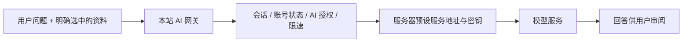

# 研序：功能审查、AI 与账号权限第一版

日期：2026-10-25。使用方式按用户确认的“管理员 + 普通用户、数据各自独立”实现。本轮已修改实际前后端，不是仅展示静态原型。

## 功能体系的判断

项目已经形成“项目 → 任务 → 实验 → 文献”的个人科研工作流，还包含里程碑、重复任务、日历、全局搜索、标签、备份、离线镜像及深浅主题。继续扩展时，应保留这些对象关系，避免把所有功能收进一个聊天窗口。

审查开始时，登录注册、密码修改、昵称、设备会话和个人模型接口已经存在。缺少的主要是平台管理层与清晰的入口。

| 模块 | 审查时的状态 | 本轮实现 |
| --- | --- | --- |
| 项目、任务、实验、文献 | 已有核心工作流与多设备镜像 | 保留原有业务，新增 AI 上下文选择 |
| AI 副驾驶 | 浏览器直连个人接口，随页面提供上下文 | 保留侧面板，补充完整结果校验、切换上下文时停止旧请求、任务批量原子写入 |
| AI 接入 | 个人地址、模型和 Key，缺少平台管理 | 新增平台模型配置、服务端网关、用户授权、请求限速与超时；保留个人接口 |
| 账号 | 已有注册、登录、改密和登录设备 | 新增独立个人账号页、注册开关展示与新登录界面 |
| 平台权限 | 已有 owner/member 字段，没有统一管理流程 | 新增管理员后台、后台授权校验、用户创建/停用/恢复、角色调整及审计 |
| 备份替换 | 清空和写入不在同一事务内 | 改为外层事务 + 内层保存点，失败或跨账号 ID 冲突时整体回滚 |

## 界面如何组织

左栏继续保留科研业务，增加 **AI 工作室**；个人账号、管理控制台和设置位于下方，避免与每天使用的科研页面抢位置。

| 页面 | 主体布局 | 设计目的 |
| --- | --- | --- |
| 登录 / 注册 | 桌面双栏，左侧淡蓝介绍区、右侧表单；手机纵向 | 简洁展示产品范围，登录动作始终明确 |
| AI 工作室 `/ai` | 主对话区 + 右侧模型来源和研究上下文 | 让用户先确定使用什么资料，再发出问题 |
| 个人账号 `/account` | 身份卡片 + 资料、安全和设备 | 不把密码、设备管理埋在冗长设置页里 |
| 管理控制台 `/admin` | 概况 + 用户、模型、权限、操作记录四页签 | 将管理任务分开，避免一屏堆叠所有表单 |
| 手机用户管理 | 每个账号一张卡片 | 角色、AI 权限与账号操作无需横向拖动 |

使用白底、浅灰与低饱和淡蓝。主色 `#4774A8`，选中底色 `#E4EEFB`，面板以细边框、有限阴影和一致留白区分层次；深色模式使用同一组语义变量。状态始终同时用文字说明。

AI 工作室以四个起始动作、足够宽的输入框和显式上下文选择建立视觉重点。界面不展示虚构趋势、假用户或假模型回答；截图中的测试账号和 `ui-test-model` 来自隔离测试服务。

## 关于 Gemini 意见

本次没有可用的 Gemini 插件、CLI 或 API 密钥，因此**没有实际向 Gemini 征询设计意见，也没有将本轮设计冒称为其意见**。可在用户提供意见后继续吸收具体反馈。

接入层已按 [Google 官方的兼容接口文档](https://ai.google.dev/gemini-api/docs/openai/) 为 Gemini 提供服务商选项。模型名称由管理员填写，不把可能过时的模型版本写死。预设地址是 `https://generativelanguage.googleapis.com/v1beta/openai`。

如需独立征询 Gemini，可使用以下提示词，不需附上真实用户资料、科研记录或密钥：

> 请审阅一款研究生个人科研工作台的界面方案。功能为项目、任务、实验记录、文献、AI 工作室、个人账号及管理员控制台；管理员与普通用户的数据完全独立，不做团队共享。用户偏好白底、浅灰、淡蓝，不喜欢青绿色或朱红。AI 工作室采用宽对话区、四个起始动作、明确的模型来源和研究上下文选择；管理员后台有用户、模型、权限、审计四个页签。请给出具体的布局、信息层级、间距、空状态、手机适配建议，并指出哪些装饰应删掉。不要只给风格形容词，也不要建议伪造数据或不可用按钮。

## 权限边界

业务使用者是管理员与普通用户两类。第一个注册的管理员在数据库中记作 `owner`，作为受保护的平台所有者；之后可授权 `admin` 管理员和 `member` 普通用户。

| 能力 | 管理员 | 普通用户 |
| --- | --- | --- |
| 管理自己的科研数据、资料与设备 | 可以 | 可以 |
| 使用已授权的平台模型 | 可以 | 可以 |
| 创建、停用、恢复普通用户 | 可以 | 不可以 |
| 调整普通用户的平台 AI 权限 | 可以 | 不可以 |
| 配置平台模型、注册方式及查看管理审计 | 可以 | 不可以 |
| 读取其他用户的科研记录 | 不可以 | 不可以 |

仅所有者可以创建和调整其他管理员；后台不能停用自己或所有者。所有限制都在服务端执行，前端隐藏入口只是辅助。停用会删除现有会话，后续登录与接口调用都会被拒绝；恢复账号不会恢复已删除的旧会话。

没有引入课题组、共享项目或只读访客。也没有为平台管理员增加代看科研内容的接口。

## AI 数据路径

- 平台模式：浏览器只向本站提交消息；模型、地址与密钥由服务端确定，用户请求不能覆盖。服务端密钥不返回前端，不写进科研备份。
- 个人模式：按账号把配置保存在本机浏览器，直接连接该用户选择的接口。本地模式与不同账号不会读取彼此的个人配置。
- 本次升级不会自动将以前全浏览器共用的个人 Key 分配给某个服务器账号；服务器账号需在自己的个人接口设置中重新填写。
- 工作室默认不附带科研记录；选择一个项目、文献或实验后才随问题发送。项目上下文包含最多 30 个相关任务，上下文截到 16000 字符。
- 原有侧面板继续按当前路由提供上下文；换记录时停止旧请求，避免旧回答混进新记录。
- 结构化动作校验完整字段、任务优先级、日期范围及重复标题；通过校验后仍需用户点击采用。任务批量写入放在一笔本地事务中。
- 同步钩子在本地事务提交后才把整批操作加入队列；本地回滚不会产生幽灵上传任务。
- 平台每个账号每分钟最多 8 次请求，单次最多 40 条消息、60000 字符，输出上限 2048 tokens，超时 60 秒；取消客户端请求会中止本网关对上游的等待。
- 审计与请求表只保存操作信息、账号、模型、状态和时间，不保存提问正文、回答正文或密钥。

当前平台模式等待一次完整回答再显示；个人接口保留原有 SSE 流式显示。这一版只有一个当前启用的平台模型，不是多模型路由或自动 Agent 执行系统。

## 使用与部署

1. 更新前备份服务器 SQLite。若原先只在浏览器本地使用，先导出科研备份；启用服务器并登录新账号后，再合并导入。
2. 启动后端：`npm run server`。迁移 v5 只增加账号状态、AI 授权及审计/请求表，不改变科研记录备份版本。
3. 第一个注册账号为平台所有者；后续用户可以从管理控制台创建，默认无需公开注册。
4. 设置对应服务商的服务端环境变量，重启服务，在控制台选择服务商、填写实际模型标识、保存并测试连接。

| 服务商 | 服务端变量 |
| --- | --- |
| Gemini | `GEMINI_API_KEY` |
| DeepSeek | `DEEPSEEK_API_KEY` |
| 智谱 | `GLM_API_KEY` |
| Kimi | `KIMI_API_KEY` |
| 自定义兼容服务 | `AI_BASE_URL` 与 `AI_API_KEY` |

变量示例位于 `deploy/env.example`。部署继续使用现有 1Panel / systemd 环境配置；普通 `node server/src/main.ts` 不会自动读取 `.env`。本地要读文件时可使用 `node --env-file=.env server/src/main.ts`。不要把真实密钥发到聊天里或提交到仓库。

管理员创建账号时设置初始密码，用户可在个人账号页修改。此版没有发送邀请邮件、邮件验证、找回密码或 MFA，不应在界面上伪装成这些功能已完成。

## 验证与后续范围

本轮最终结果：27 个测试文件、160 个用例通过；生产构建通过；新页面浏览器检查 26/26 通过；服务器流程检查 13/13 通过。服务器流程使用 `node scripts/verify-server.mjs --fast-timers`，仅在测试浏览器中把 15 秒自动重试时钟缩为 300ms，仍通过真实离线与自动补传链路。生产重试间隔保持不变。

- `npm test`：覆盖账号隔离、后台越权、所有者保护、停用及恢复、平台模型参数不可伪造、密钥不泄露、AI 实时授权、输入限额、备份整体回滚、个人配置隔离及 AI 结构化结果校验。
- `npm run build`：检查 TypeScript 与生产构建。
- `npm run verify:platform`：独立临时数据库、账号与本机测试模型，验证前端创建用户、保存配置、测试连接、发送问题，以及 1440 / 768 / 390px 页面布局和深色模式。
- 截图与浏览器报告在 `shots/platform/`，其中测试回答明确标为测试模型，不代表已连接真实 Gemini。

尚未验证真实外部模型、实际服务器部署和非 Chromium 浏览器。平台限速是单实例 SQLite 计数，没有计费、月度预算或余额体系。离线模式保留原有浏览器镜像；服务器吊销权限不能远程抹去已经离线的副本。

构建仍有主 JavaScript 包约 1.25MB（gzip 约 379KB）的体积提示，需要后续按路由和数学渲染模块拆包；本轮没有为了消除提示而隐藏构建警告。

接下来优先补齐真实服务商联调、AI 会话历史、请求统计的保留策略、模型费用预算与生产构建拆包。更大的权限矩阵、团队协作、自动执行工具不属于这一版。
